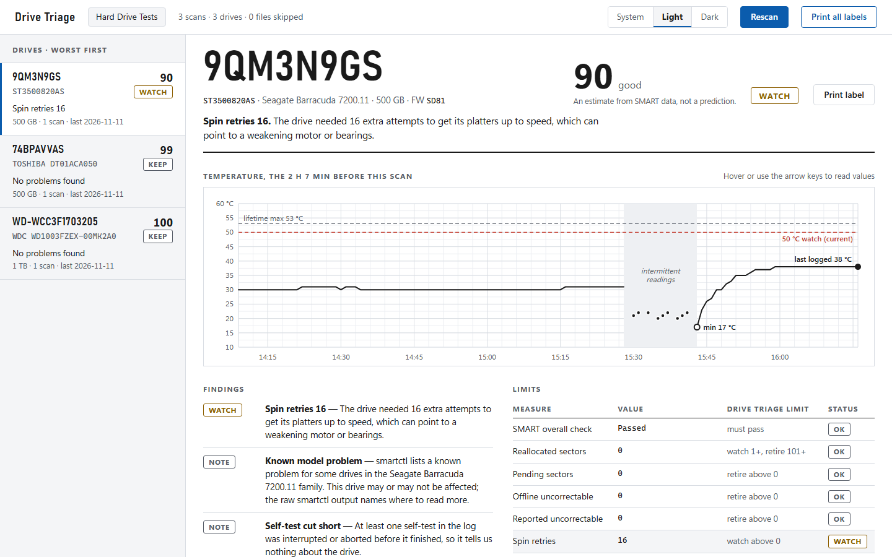

# Drive Triage

Drive Triage reads the SMART scans that GSmartControl (smartctl) saves as JSON for each hard drive, groups them per drive, and gives every drive a verdict (KEEP, WATCH or RETIRE) plus a 0-100 health score, with plain-English reasons. It can also print a 2" x 1" thermal label for each drive. It is meant for sorting a pile of old drives: open the page, point it at your scan folder, and see which drives to keep using, which to watch, and which to retire.

It is a single local web page. There is no install, no server, no database and no internet connection. Your scan files are the history; the page only reads them. The only things kept in the browser are the remembered folder handle and the theme choice.

## Screenshots

Light theme:



Dark theme:


These screenshots show three real scans: a Seagate Barracuda 7200.11, a Toshiba DT01ACA050 and a WD Black.

## Quick start

1. Download or clone this repository.
2. Double-click `Drive-Triage.html`. It opens from disk in your browser.
3. Choose your scans folder when asked. The page only reads it.

Edge or Chrome is recommended. They remember the folder between visits, so you only pick it once; on a return visit you may need to click Reopen and allow read access. In other browsers the page still works, but you choose the folder with a folder picker each visit.

Each drive is named by its serial number, in the app and on its label. Scans are grouped into drives by serial number and model, so you can keep every scan in one folder with GSmartControl's default file names, or organise them into subfolders however you like:

```
Hard Drive Tests/
  ST3500820AS_9QM3N9GS_2026-11-11_1618.json
  TOSHIBA_DT01ACA050_74BPAVVAS_2026-11-11_1731.json
  WDC_WD1003FZEX-00MK2A0_WD-WCC3F1703205_2026-11-11_2030.json
```

Scans with the same serial number and model are one drive, wherever they sit; each new scan adds to that drive's history. Files that are not JSON, or not smartctl scans, are skipped and counted in the status line.

Only ATA/SATA drives are supported so far. NVMe and SAS scans are listed as not supported yet.

## Making scans

- In GSmartControl, run the tests and save the report as JSON. Or from the command line, `smartctl -x --json=o <device>` (add `-d sat,16` for a USB bridge). Use `-x`, not `-a`: `-a` leaves out the SCT temperature history and the extended self-test log. Use `--json=o`, not plain `-j`: the `o` keeps smartctl's text output, which the page uses for model warnings and shows as the raw output.
- On USB or SATA bridges, scan with `-d sat,16` rather than `sat,12`. The 12-byte mode often cannot read every log, and the page will tell you when a scan looks like that.
- Run an extended (long) self-test before saving the scan. Without one, the drive gets a "No long self-test yet" watch finding, and a long test that is much older than the scan is flagged as out of date.

## How verdicts work

Each drive's most recent scan is checked against a fixed set of rules. The verdict is the worst severity found:

- **RETIRE**: at least one retire finding.
- **WATCH**: no retire findings, at least one watch finding.
- **KEEP**: neither.

There are also notes (for example a cable-error count or a model warning from smartctl). Notes explain things but never change the verdict.

The health score is a deterministic estimate, not a prediction: the same scans always give the same number. It starts at 100 and subtracts points for the findings below (and for the reallocated-sector count, and for drive age beyond 20,000 power-on hours, up to 15 points), then is capped for serious problems (at most 39 for RETIRE, at most 10 if SMART failed, an attribute is failing now, or the last self-test failed). Bands: 80-100 good, 50-79 fair, 0-49 poor.

Vendor quirks are handled so healthy drives are not flagged. In particular, Seagate packs several counters into the RAW values of attributes 1, 7 and 195, so those raw values are never used; their normalized values are judged like any other attribute.

Main triggers:

| Verdict | Trigger |
| --- | --- |
| RETIRE | Overall SMART health failed |
| RETIRE | An attribute is failing now |
| RETIRE | The last self-test failed |
| RETIRE | Any pending sectors (197), offline uncorrectable sectors (198) or reported uncorrectable errors (187) |
| RETIRE | More than 100 reallocated sectors (5) |
| RETIRE | Reallocated, pending, offline or uncorrectable counts grew since the previous scan |
| WATCH | 1 to 100 reallocated sectors |
| WATCH | Any spin retries (10) |
| WATCH | More than 5 command timeouts (188) |
| WATCH | An attribute within 10 points of its failure threshold (while below 100; temperature attributes 190 and 194 are excluded) |
| WATCH | An attribute that hit its failure limit in the past (for 190 and 194 this is only a note) |
| WATCH | Reached 55 C in its lifetime, or currently at 50 C or more |
| WATCH | 50,000 power-on hours or more |
| WATCH | No extended self-test in the log, or the last passing one is more than 168 power-on hours older than the scan |

The exact numbers, and the point deductions behind the score, live in the `RULES` table at the top of `analysis.js`.

## Labels

Each drive can print a 2" x 1" label (one drive, or all drives at once), carrying:

1. Drive name and health score (inverted box)
2. Vendor, model and capacity
3. Serial number
4. Power-on hours and years, reallocated and pending sector counts
5. The top watch or retire finding, or the lifetime maximum temperature if there is none
6. Scan date and the latest extended self-test result (PASS, FAIL or none)

The verdict word is not printed; the health score is. Long models and serials shrink to fit their line, with text kept at 6 pt or larger; a line that still does not fit at 6 pt is cut off with an ellipsis. Labels always print black on white, whatever theme the page is in.

Printer setup, in the print dialog and printer driver:

- Paper size: 2" x 1" (or 51 x 25 mm), matching your label roll
- Scale: 100% / Actual size
- Margins: None
- Headers and footers: off

## Themes

The page follows your system light or dark setting and updates if it changes. The System / Light / Dark switch in the header overrides it, and your choice is remembered on this machine.

## Privacy and safety

Drive Triage runs entirely in your browser, offline. It never modifies, moves or deletes your scan files (the folder is opened read-only), and nothing is uploaded anywhere.

## Development

Plain HTML, CSS and JavaScript with no build step. Tests use the Node test runner (Node 24):

```
node --test
```

Layout:

- `Drive-Triage.html`: the page
- `analysis.js`: pure logic (parsing, grouping, verdict rules, health score, label text), no DOM
- `app.js`: the UI, folder reading, theme and label printing
- `styles.css`: styles
- `test/`: unit tests and fixtures
- `docs/superpowers/`: design spec and implementation plan

CI runs the tests on every pull request and on pushes to `main`.

## Roadmap

Running Drive Triage as a lightweight homelab service, using the same analysis code, is being considered: [issue #6](https://github.com/russella02/Drive-Triage/issues/6).

## License

MIT. See [LICENSE](LICENSE).
