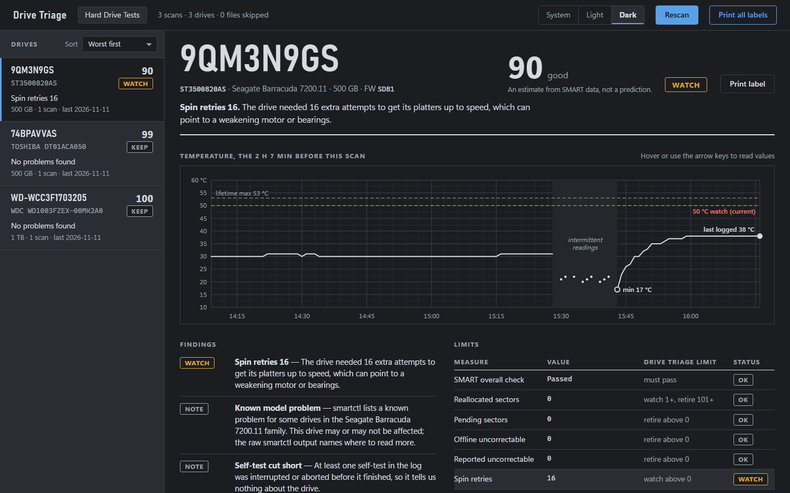
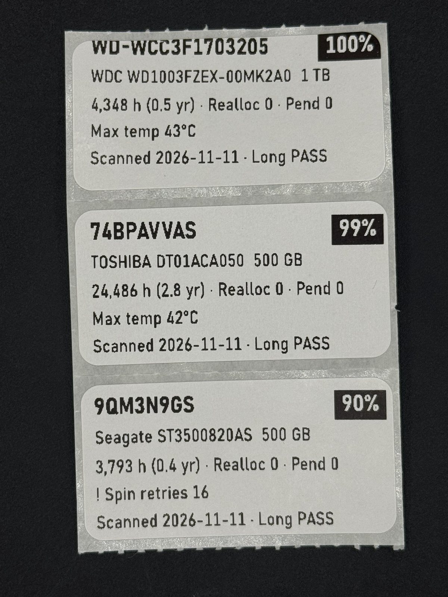

# Drive Triage

<p align="center">
  <a href="https://russella02.github.io/Drive-Triage/"></a>
  <a href="https://github.com/russella02/Drive-Triage/actions/workflows/test.yml"></a>
  <a href="https://github.com/russella02/Drive-Triage/releases/latest"></a>
  <a href="LICENSE"></a>
  
  
</p>

I had a pile of old hard drives and no quick way to tell which ones were still worth using. Drive Triage is what I built to sort them.

You scan each drive with [GSmartControl](https://gsmartcontrol.shaduri.dev/) (smartctl) and save the report as JSON. Drive Triage reads those files, groups them by drive, and gives each drive a verdict: KEEP, WATCH or RETIRE. Each drive also gets a 0-100 health score and the reasons behind it, in plain English. It can print a 2" x 1" thermal label for each drive too.

It's a single web page. Use it online or open it from disk. Either way there's nothing to install, no server to run and no database, and your scan files never leave your computer. The scan files are the history; the page only reads them. All the browser remembers is your folder, your theme and how you sort the list.

## Screenshots

Light theme:


Dark theme:



These are three real scans: a Seagate Barracuda 7200.11, a Toshiba DT01ACA050 and a WD Black.

## Quick start

  

Use it online at https://russella02.github.io/Drive-Triage/ (Edge or Chrome), or run it from disk:

1. Download or clone this repository.
2. Double-click `Drive-Triage.html` to open it in your browser.
3. Choose your scans folder when asked. The page only reads it.

Edge and Chrome work best, because they remember the folder, so you only pick it once. On a return visit you may need to click Reopen and allow read access. Other browsers work too, but you have to pick the folder every time.

Drives are named by serial number, both in the app and on the label. Scans are grouped by serial number and model, so one folder with GSmartControl's default file names is enough. Subfolders are fine too, organised however you like:

```
Hard Drive Tests/
  ST3500820AS_9QM3N9GS_2026-11-11_1618.json
  TOSHIBA_DT01ACA050_74BPAVVAS_2026-11-11_1731.json
  WDC_WD1003FZEX-00MK2A0_WD-WCC3F1703205_2026-11-11_2030.json
```

Scans with the same serial number and model count as one drive, wherever they sit. Each new scan adds to that drive's history. The list shows the drives that need attention first. To change that, use the Sort menu above the list: best first, serial, model, capacity or last scanned. Your choice is remembered on this machine.

Anything that isn't a smartctl JSON scan is skipped and counted in the status line.

Only ATA/SATA drives are supported for now. NVMe and SAS scans show up as not supported yet.

## Making scans

<a href="https://gsmartcontrol.shaduri.dev/downloads"></a>

You need [GSmartControl](https://gsmartcontrol.shaduri.dev/downloads), a free SMART tool that comes with smartctl. Get it from the official site.

- In GSmartControl, run the tests and save the report as JSON. From the command line, use `smartctl -x --json=o <device>` (add `-d sat,16` for a USB bridge).
  - Use `-x`, not `-a`. `-a` leaves out the SCT temperature history and the extended self-test log.
  - Use `--json=o`, not plain `-j`. The `o` keeps smartctl's text output, which the page uses for model warnings and shows as the raw output.
- On USB or SATA bridges, scan with `-d sat,16`, not `sat,12`. The 12-byte mode often can't read every log, and the page tells you when a scan looks like that.
- Run an extended (long) self-test before you save the scan. Without one, the drive gets a "No long self-test yet" watch finding. A long test much older than the scan is flagged as out of date.

## How verdicts work


Each drive's latest scan is checked against a fixed set of rules, and the worst finding sets the verdict:

- **RETIRE**: at least one retire finding.
- **WATCH**: no retire findings, at least one watch finding.
- **KEEP**: neither.

Some findings are only notes, like a cable-error count or a model warning from smartctl. Notes explain things but never change the verdict.

The health score is an estimate, not a prediction, and the same scans always give the same number. It starts at 100 and loses points for:

- the findings below,
- the reallocated-sector count,
- age past 20,000 power-on hours (up to 15 points).

Then it's capped for serious problems:

- at most 39 for RETIRE,
- at most 10 if SMART failed, an attribute is failing now, or the last self-test failed.

Bands: 80-100 good, 50-79 fair, 0-49 poor.

Vendor quirks are handled so healthy drives don't get flagged. For example, Seagate packs several counters into the RAW values of attributes 1, 7 and 195. Those raw values are never used; the normalized values are judged like any other attribute.

Main triggers:

| Verdict | Trigger |
| --- | --- |
| RETIRE | Overall SMART health failed |
| RETIRE | An attribute is failing now |
| RETIRE | The last self-test failed |
| RETIRE | Any pending sectors (197), offline uncorrectable sectors (198) or reported uncorrectable errors (187) |
| RETIRE | More than 100 reallocated sectors (5) |
| RETIRE | Reallocated, pending, offline or uncorrectable counts grew since the previous scan |
| WATCH | 1 to 100 reallocated sectors |
| WATCH | Any spin retries (10) |
| WATCH | More than 5 command timeouts (188) |
| WATCH | An attribute within 10 points of its failure threshold (while below 100; temperature attributes 190 and 194 are excluded) |
| WATCH | An attribute that hit its failure limit in the past (for 190 and 194 this is only a note) |
| WATCH | Reached 55 C in its lifetime, or currently at 50 C or more |
| WATCH | 50,000 power-on hours or more |
| WATCH | No extended self-test in the log, or the last passing one is more than 168 power-on hours older than the scan |

The exact numbers, and the points behind the score, are in the `RULES` table at the top of `analysis.js`.

## Labels


You can print a 2" x 1" label for one drive or for all of them at once. Each label shows:

1. Drive name and health score (inverted box)
2. Vendor, model and capacity
3. Serial number
4. Power-on hours and years, reallocated and pending sector counts
5. The top watch or retire finding, or the lifetime maximum temperature if there is none
6. Scan date and the latest extended self-test result (PASS, FAIL or none)

Here are the labels for the three drives in the screenshots, printed on a 2" x 1" thermal roll:



The label shows the health score, not the verdict word. Long models and serials shrink to fit their line, but never below 6 pt; a line that still doesn't fit gets cut off with an ellipsis. Labels always print black on white, whatever theme the page is in.

Printer setup, in the print dialog and printer driver:

- Paper size: 2" x 1" (or 51 x 25 mm), matching your label roll
- Scale: 100% / Actual size
- Margins: None
- Headers and footers: off

## Themes

The page follows your system's light or dark setting, and switches when it changes. To override it, use the System / Light / Dark switch in the header. Your choice is remembered on this machine.

## Privacy and safety

Everything runs in your browser, whether you open it online or from disk. The folder is opened read-only, so your scan files are never changed, moved or deleted, and nothing is uploaded anywhere.

## Development

Plain HTML, CSS and JavaScript, with no build step. Tests use the Node test runner (Node 24):

```
node --test
```

Layout:

- `Drive-Triage.html`: the page
- `analysis.js`: pure logic (parsing, grouping, verdict rules, health score, label text), no DOM
- `app.js`: the UI, folder reading, theme and label printing
- `styles.css`: styles
- `test/`: unit tests and fixtures

CI runs the tests on every pull request and every push to `main`.

## Roadmap

I'm considering running Drive Triage as a lightweight homelab service, using the same analysis code: [issue #1](https://github.com/russella02/Drive-Triage/issues/1).

## License

MIT. See [LICENSE](LICENSE).
